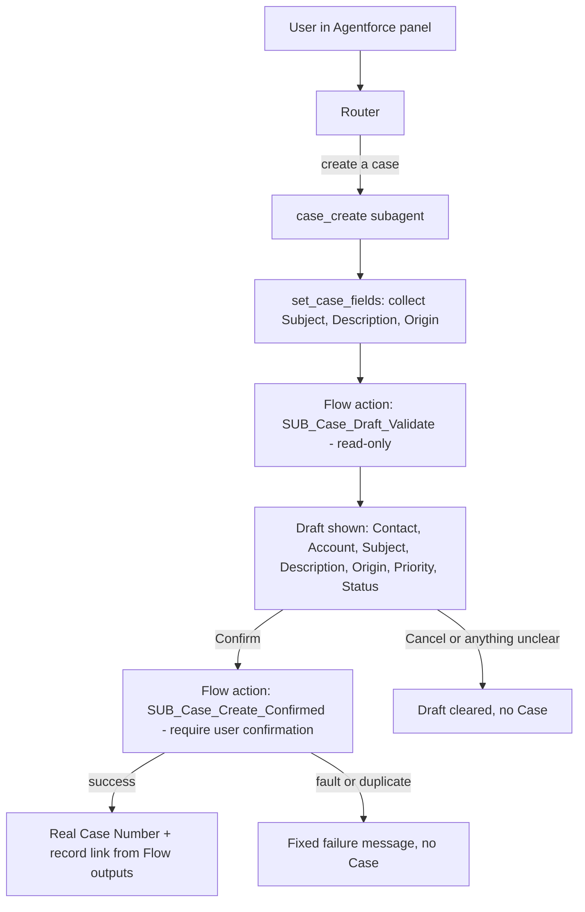

# Case creation with confirmation — design for Lal's approval

**Status:** PROPOSED, not built (decision: design only, wait for Lal, 2026-11-27). **Ticket:** SCGOE-95.
**Decision draft:** `context/decisions/2026-11-27-case-create-with-confirmation.md`

Nothing in this document exists in the org. No Case, Flow, permission set or agent version was created for it.

## 1. What Lal is asked to approve

The current requirements make the agent read-only (O11; T1–T3 "no business-record DML"; ADR-004; K-R8; the agent's
system instruction). Case creation needs Lal to supersede that **for creating a Case only**: no update, delete,
merge, assignment or email, and no change to any other object. The Contact search action stays read-only and unchanged.

## 2. Org facts the design relies on (checked read-only, MAX, 2026-11-27)

| Fact | Value |
|---|---|
| Case createable by the admin | Yes. Record types: Master only |
| Case validation rules | None |
| Apex triggers / active record-triggered flows on Case | None |
| Required by the API | OwnerId only (defaults to the running user) |
| Status | Picklist, default New |
| Priority | Picklist, default Medium (High, Medium, Low) |
| Origin | Picklist, no default, not required by the API (Phone, Email, Web) |
| Case sharing default | Public Read/Write/Transfer |
| Existing Cases | 26 (Salesforce sample data) |
| Existing `Create_Case` screen flow | A Salesforce template flow; not an approved action, not reused |

## 3. Architecture (native first)

| Component | Type | Purpose |
|---|---|---|
| `DATA_Case_Create` ("DATA – Case – Create") | Permission set | Case Read + Create; FLS Read/Edit on Subject, Description, Origin, Priority, ContactId, AccountId; Read on Status, CaseNumber. Assigned only with Lal's approval |
| `SUB_Case_Draft_Validate` | Autolaunched Flow, user context | Read-only. Gets the Contact the user selected (user context, so sharing and object access apply), its Account (only if readable), checks Subject 1–255, Description ≤ 32,000, Origin in the active list. Returns `isValid`, `message`, the draft values and a draft token |
| `SUB_Case_Create_Confirmed` | Autolaunched Flow, user context | Re-runs the same checks, then the duplicate guard (§5), then Create Records (Case) with a fault path, then Get Records for CaseNumber. Returns `success`, `caseNumber`, `caseId`, `message` |
| `case_create` | Agent Script subagent | Collects fields, runs the validate flow deterministically, shows the draft, exposes Confirm only while a valid draft exists |
| Router + read-only guard | Agent Script edit | "Create a case" routes to `case_create`; every other write request still goes to the read-only guard |

No Apex, no LWC. The Contact search Apex is not touched.

### Field rules

| Field | Source | Rule |
|---|---|---|
| Contact | `selected_contact_id` from a search result only | Never a typed name or an invented Id. If no single Contact is selected, the agent asks the user to search first |
| Account | The Contact's own `AccountId` | Never typed separately, so a Case can't pair a Contact with another Account. Shown only if the user can read Account Name |
| Subject | User | Required, 1–255 characters |
| Description | User | Required (proposed), up to 32,000 characters |
| Origin | User picks Phone, Email or Web | Required (proposed; Lal may prefer a fixed value) |
| Priority | Default Medium | User may change to High or Low |
| Status | Default New | Not editable through the agent |
| Owner | Running user (platform default) | Not editable |

## 4. Confirmation UI — verification and fallback

**Verification so far (documentation only; nothing may be built yet).** Salesforce documents agent flow actions as
autolaunched flows; I found no documentation of a Screen Flow showing its screens inside the Agentforce panel when an
agent calls it. Agent Script does document a `require_user_confirmation` setting on actions ("Require user
confirmation" in Agent Builder; `isConfirmationRequired` in metadata), which asks the user before the action runs.

| Option | How Confirm/Cancel appears | Fit |
|---|---|---|
| A. Screen Flow in the panel | Native flow screen | **Unverified, probably unsupported.** First build step: a throw-away test in MAX with no DML. Use only if it renders |
| B. Platform action confirmation (recommended fallback) | Draft shown by the agent; the create action has `require_user_confirmation: True`, so the platform asks before it runs | Native, no LWC. Exact rendering in the Lightning panel to be verified (V-1) |
| C. Custom Lightning Type card | Buttons on an LWC card | Real buttons, but needs a custom LWC, which T3 excludes; needs a separate exception |

Whatever the option, the script also gates the create action: it is available only while a validated draft and an
unused draft token exist, so it can't run before the draft is shown.

## 5. Safeguards

| Requirement | How |
|---|---|
| No Case before Confirm | Create action available only with a valid draft and token; plus platform confirmation |
| Cancel, unclear reply or failure → no Case | Cancel and any reply that isn't an explicit confirmation clear the draft and token; flow fault path returns `success=false` |
| Exactly one Case per confirmation | Token is cleared after the first run (single-use). The create flow also looks for a Case created by the same user, for the same Contact and Subject, in the last 10 minutes and returns it as a duplicate instead of creating another. Stronger option: a custom External Id request key on Case (needs Lal to lift ADR-004's no-custom-fields rule) |
| Case Create permission, FLS | Flows run in user context; Create Records fails without Case Create or field Edit, and the fault path reports it neutrally (to verify V-2) |
| Contact/Account access | Contact read in user context; a hidden Contact reads exactly like a missing one ("I couldn't find that Contact"); Account taken from the Contact |
| Required fields | Validated in the draft flow and again before create |
| Never invent success | The reply is built only from the create flow's outputs; no Case Number appears unless `success = true` and `caseNumber` is not blank |
| Record link | `/lightning/r/Case/{caseId}/view`, from the returned Id only |
| Audit | Case CreatedBy / CreatedDate; agent session trace |

## 6. Verification items for the build

- **V-1** How `require_user_confirmation` renders in the Lightning panel (and in preview).
- **V-2** The flows run in user context: a user without Case Create gets the neutral failure, and a hidden Contact is "not found".
- **V-3** Option A throw-away Screen Flow test (no DML), then delete it.
- **V-4** The duplicate guard query uses only fields the user can read.

## 7. Test plan (to run after approval; needs synthetic Case writes, which were declined for now)

| ID | Test | Expected |
|---|---|---|
| TC-1 | Full draft, Confirm | Exactly one Case; real Case Number and link; fields as shown in the draft |
| TC-2 | Full draft, Cancel | No Case (count before = after) |
| TC-3 | Draft, unclear reply ("maybe") | No Case; asks again or clears |
| TC-4 | Confirm sent twice / repeated | One Case only (token + duplicate guard) |
| TC-5 | "Create a case" with no Contact selected | Asks to search first; no Case |
| TC-6 | Hidden Contact Id | "Couldn't find that Contact"; no Case; no existence leak |
| TC-7 | Missing Subject / over-long Subject / invalid Origin | Draft not valid; specific ask; no Case |
| TC-8 | Restricted user without Case Create | Neutral failure; no Case |
| TC-9 | Restricted user without Description FLS | Neutral failure or field excluded per Lal's choice; no Case |
| TC-10 | Flow fault (forced) | Fixed failure message; no Case Number shown |
| TC-11 | Contact on an Account the user can't read | Case created with Account set by the platform rule chosen by Lal; Account name not shown |
| TC-12 | Other write requests (update a Contact, delete a Case) | Still refused by the read-only guard |
| TC-13 | Contact search, Contact Id, Account Id, Knowledge, combined request | Unchanged (regression, targeted) |
| TC-14 | Agent trace for TC-1 | Real flow action ran; Case Id in the output matches the record |

Test data: Cases marked `CRA-TEST` in Subject, linked only to CRA-TEST Contacts, kept as evidence or deleted with approval.

## 8. Effort and order once approved

1. Permission set + the two flows (validate first with a check-only deploy).
2. V-1 to V-3.
3. Agent Script subagent, router and read-only guard changes; preview tests.
4. Publish one new version Inactive (combine with AID-1 if not yet published).
5. TC-1–TC-14 with approved synthetic writes and a restricted test user.
